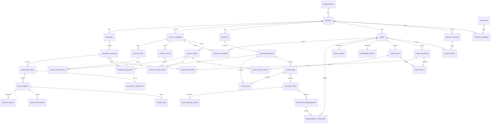

> 워크스페이스 재배치본 v1.1.0 / 2026-10-23. 경로 변경은 구조 결정이며, 업무 규칙과 기술 제안의 승인 상태는 승격하지 않습니다.

# 02. PostgreSQL ERD·데이터베이스 개발 기술서

> 상태: PROPOSED. 이 문서를 먼저 검토한 후 Backend/Frontend DTO를 확정한다.
> 사용자 데이터 기준: [08](../domain/08_catalog_processes.md). JSON 계약: [03](../../contracts/03_domain_contracts.md).
> 초기 초안의 equipment/storage 분리안 대신 공통 `asset` + 하위 상세 테이블을 제안한다.
> 목적은 자산 포트·그룹·배치·감사에서 다형 참조를 줄이기 위함이다. 기존 DB가 있다면 즉시 교체하지 말고 마이그레이션 계획부터 제시한다.

## 1. 설계 원칙

1. UUID 내부 ID는 고정, EQ/ST 표시 코드·정렬은 변경 가능.
2. 프로젝트 자원은 모두 project_id를 갖고 FK까지 프로젝트 일치를 강제.
3. 공정 흐름(논리 그래프)과 운반 통로(물리 그래프)를 분리.
4. 제품 공정, 자산 설정, 배치, 시나리오는 각각 버전 관리.
5. 실행 입력은 완전한 불변 스냅샷. 승인 버전도 실행 시점에 복제하여 보존.
6. FK가 필요한 관계는 컬럼/관계 테이블로 저장. JSON의 임의 ID만으로 연결하지 않음.
7. JSONB는 종류별 수량/시간/잔량 정책에만 사용하고 schema_version으로 검증.
8. 현재 전선 공장은 예제 project. 모든 사업체를 같은 EQ 코드 전역 UNIQUE로 제한하지 않음.
9. 승인 상태와 실행 준비 상태는 다르다. 명시적 UNKNOWN을 포함한 지식 승인 가능.
10. 현재 이 문서의 SQL은 제약 패턴 예시이며 전체 실행용 DDL이 아니다.

## 2. 핵심 ERD



ERD는 주요 관계다. 자세한 유일성·소유권·연결 규칙은 아래 표와 제약 목록이 우선한다.

## 3. 공통 컬럼·자료형

모든 일반 엔터티:
- `id uuid PK`: 앱에서 생성. DB UUID 생성 확장에 의존하지 않음.
- `created_at timestamptz`, `created_by uuid NULL`
- 수정 가능한 행에 `updated_at`, `updated_by`, `row_version bigint NOT NULL DEFAULT 1`
- 보관 가능한 기준정보에 `archived_at timestamptz NULL`
- 사용자 도메인 설명에 `notes text`, 필요한 경우 `field_meta jsonb NOT NULL DEFAULT '{}'`
- 프로젝트 소유 행에 `project_id uuid NOT NULL`, `UNIQUE(project_id,id)`
- 하위 버전 소유 행에 `project_id`, `..._version_id`와 해당 복합 FK

숫자:
- 길이·중량·선속·용량: `numeric(24,6)`; 범위 밖 입력 거부.
- 시뮬레이션 시간: DB `double precision`, finite/nonnegative 검증; 세부 비교 허용오차 명시.
- 횟수·보빈 수: `bigint` 및 양수/0 허용 의미별 CHECK.
- 상태: 초기에는 `text + CHECK`, 허용값은 DTO와 공유. 무관리 자유 문자열 금지.
- JSONB: 기본 `{}`가 미정 필드를 숨기지 않도록 모델별 schema_version·필수 discriminant 검증.
- 개인정보/비밀값/원본 CAD 전체를 JSONB 설정에 넣지 않는다.

## 4. 단계 A — 프로젝트·기준정보

| 테이블 | 필수 업무 컬럼 및 관계 | 주요 제약 |
|---|---|---|
| organization | name, code, status | code 고유 |
| app_user | auth_issuer, auth_subject, display_name, status | UNIQUE(issuer,subject); 외부 인증 연결 |
| organization_member | organization_id, user_id, role | 조직/사용자/역할 유일 |
| project | organization_id, code, name, timezone, description, status | UNIQUE(organization_id,code); project root |
| project_member | project_id, user_id, role | 사용자·역할 중복 금지; 조직 멤버 확인 |
| project_group | project_id, parent_id NULL, code, name, group_type | parent 동일 project; 순환 금지 |
| asset | project_id, kind, code, name, sort_order, external_ref NULL | kind equipment/storage/dock; UNIQUE(project_id,code) |
| equipment_detail | project_id, asset_id PK, equipment_type, model_name NULL | asset.kind=equipment 검증 |
| space_detail | project_id, asset_id PK, space_type | storage/dock만; 공간 용량은 revision |
| asset_alias | project_id, asset_id, alias, source | 동일 asset 별칭 중복 금지; 별칭 전역 유일 강제 안 함 |
| group_asset | project_id, group_id, asset_id, role | UNIQUE(project_id,group_id,asset_id) |
| asset_port | project_id, asset_id, port_key, role, label | port_key 자산 내 고유; 설비 IN/OUT 각 1개; 공간 ACCESS 기본 1개 |
| asset_revision | project_id, asset_id, revision_no, status, properties, approved_at/by | UNIQUE(asset_id,revision_no); 승인 후 불변 |
| port_policy | project_id, asset_revision_id, asset_id, port_id, capacity_rule, dispatch_rule, release_rule | 동일 asset의 revision·port만 연결 |
| audit_log | organization_id, project_id NULL, actor_id, action, entity_type, entity_id, before/after, request_id | append-only; 민감 필드 마스킹 |

equipment_detail은 식별 분류만, 능력·운전 용량·가용 달력·버퍼 정책은 asset_revision.properties/port_policy.
asset.code/name 변경은 식별 표시 변경이며 과거 snapshot에는 당시 표시를 보존한다.
asset_revision은 승인을 위한 상태와 미정 필드를 보유할 수 있다. 시나리오는 승인된 revision을 명시적으로 선택한다.

> **구현 반영(migration 0001·0002, 승인 CR 기준, 이 ERD 표와 다른 점만):**
> - 0001: `project_member`·`audit_log`에 `organization_id`(복합 FK로 조직 멤버·프로젝트 일치 강제), `equipment_detail`·`space_detail`·`asset_port`에
>   `asset_kind`(복합 FK로 subtype·포트 role 일치 강제), 조직당 사용자 1역할(`UNIQUE(organization_id,user_id)`), `audit_log` append-only 트리거,
>   설비 IN/OUT·공간 ACCESS≥1 지연 제약 트리거. 근거: [CR be01-contract-gaps §6](../change-requests/CR-backend-20261023-be01-contract-gaps.md).
> - 0002: 범용 `properties jsonb` 대신 `asset_revision.storage_capacity`(공간만, 설비는 NULL)를 두고, `port_policy`는 **설비 IN/OUT 포트에만** 만든다.
>   상태는 `draft|in_review|approved|superseded`, 자산당 열린 버전·승인본 각 1개(부분 유일 인덱스), 상태 전이·초안 외 내용 동결·부모가 초안일 때만 정책 변경을 트리거로 강제.
>   `field_meta`는 두지 않았다(용량 `status`가 미정을 표현). 근거: [CR be02 §4-1](../change-requests/CR-backend-20261023-be02-asset-revision-capacity.md).
> - 이 ERD 문서의 승인 상태(PROPOSED)는 바뀌지 않았다. 위는 구현이 따른 해석의 기록이다.

### 포트 정합성

- 설비 생성 서비스는 asset + equipment_detail + IN/OUT을 같은 트랜잭션에서 생성.
- `UNIQUE(project_id,asset_id,port_key)`로 포트 키 중복 방지.
- IN/OUT 역할은 해당 역할에 대한 부분 유일 인덱스로 각각 한 개를 강제.
  ACCESS는 ACCESS-01/02처럼 port_key를 달리해 추후 여러 접근 지점을 지원.
- “정확히 IN/OUT 2개 존재”는 CHECK 한 줄로 다른 행을 세지 않는다.
  서비스 테스트 + 커밋 시 지연 제약 트리거로 보장하는 것을 제안한다.
- 공간의 ACCESS는 물리 포인트일 뿐 저장 용량을 따로 중복 계산하지 않는다.
- 공간 capacity는 asset_revision의 저장 용량, IN/OUT capacity는 port_policy의 버퍼 용량.
- 도킹이 대기 적재를 허용하는지는 UNKNOWN이며 실제 포트가 있다고 용량을 무제한으로 해석하지 않는다.

## 5. 단계 A — 제품·공정 정의

| 테이블 | 업무 컬럼 및 관계 | 제약 |
|---|---|---|
| product | project_id, code, name, specification | 프로젝트 내 코드 고유 |
| material_definition | project_id, code, name, form, default_spec | 원자재/반제품 종류. 공정 단계와 독립된 재료 식별 |
| process_version | project_id, product_id, version_no, status, schema_version, base_version_id NULL, raw_unit_spec, finished_unit_spec, completion_node_id NULL | version 고유, 승인 후 수정 금지 |
| flow_node | project_id, process_version_id, node_key, kind, label, asset_id NULL, milestone_type NULL, input_match_policy, display_order | kind source/buffer/operation/join/milestone/sink |
| process_step | project_id, process_version_id, node_id UNIQUE, operation_type, handler_version, timing_rule, output_rule, material_rule, handoff_rule, execution_rule | node.kind=operation; 선속·규칙 JSON 검증 |
| resource_requirement | project_id, process_version_id, step_id, role_key, resource_kind, selection_mode, required_count, capacity_mode, allocation_rule | 역할 키 단계 내 고유 |
| requirement_candidate | project_id, process_version_id, requirement_id, asset_id, eligibility_status, parameter_override | 프로젝트 동일; 조건 override 스키마 검증 |
| step_material_spec | project_id, process_version_id, step_id, spec_key, direction, material_definition_id NULL, state_code, form, length_m NULL, weight_kg NULL, unit_count NULL, strand_count NULL, quantity_basis, field_meta | 숫자/상태 조건, spec_key 유일 |
| flow_edge | project_id, process_version_id, edge_key, from_node_id, to_node_id, edge_kind, source_output_spec_id NULL, target_input_spec_id NULL, movement_rule, condition_rule | 양끝 동일 버전; type material/precedence/supply |
| process_editor_state | project_id, process_version_id, user_id NULL, node_positions, viewport, row_version | 화면 좌표 전용, 물리 위치와 무관 |
| validation_report | project_id, target_kind, target_id, target_row_version, scope, content_hash, issues, validated_at | 범용 참조는 감사용; 운영 FK 대신 쓰지 않음 |
| change_request | project_id, target_kind, target_id, description, status, decided_by/at | 변경 승인/질문 이력; 근거 원문 보존 |

### 연결 모델

공정 그래프에서 저장공간은 명시적인 buffer 노드다.
예: operation(절연) → buffer(ST-011) → operation(조사).
물류 경유도 operation(테이핑) → buffer(ST-022) → buffer(ST-009) → operation(쉬스).

- buffer/source/sink 노드는 asset_id로 실제 공간을 참조할 수 있다.
- operation 노드는 자산 하나를 직접 박지 않고 resource_requirement의 후보에서 선택.
- operation에서 나가는 material edge는 선택 자산 OUT, 들어오는 edge는 선택 자산 IN으로 실행 시 해석.
- 같은 물리 공간을 방문해도 공정상 역할이 다르면 flow_node는 별도, asset_id는 동일.
- join은 준비 조건을 나타내며 설비로 집계하지 않음.
- supply는 원자재 지원/직결 공급, precedence는 완료 의존성. 단순 운반과 혼용 금지.
- source_output_spec/target_input_spec은 필요할 때 매칭을 엄격히 지정.
  연결된 spec이 실제 endpoint step에 속하는지 서비스 검증.
- 동일 asset로 재방문하는 경로는 정상. 그래프의 실제 순환·재작업은 초기 비지원, 등록은 경고/실행 차단.

### 설비 후보 선정

`selection_mode=one_of`: 후보 가운데 required_count개를 고르는 방식.
`selection_mode=all_of`: 표시된 필수 구성 자원을 모두 확보.
후보 qualification이 UNKNOWN이면 시나리오에서 가정 승인 전 실행 불가.
그룹 전체가 미래에 자동 후보로 늘어나지 않게 승인 시 candidate ID를 고정한다.
노동자 무제한은 `resource_kind=worker, capacity_mode=unlimited`; 가짜 EQ 설비를 생성하지 않는다.

## 6. 단계 C — 시나리오·실행·결과

| 테이블 | 업무 컬럼 | 주의 |
|---|---|---|
| scenario | project_id, name, description | 변경 이력의 root |
| scenario_version | project_id, scenario_id, version_no, status, layout_version_id NULL **(구현 0013, 승인 배치판)**, travel_rule **(구현 0013, 속도 km/h·상하차 분, 비면 기본 4 km/h·1분)**, calendar_rule, arrival_rules, initial_wip, stopping_rule, assumptions, engine_options | 승인 후 불변 |
| scenario_product | project_id, scenario_version_id, product_id, process_version_id, production_plan, priority | product와 version 일치 |
| scenario_asset | project_id, scenario_version_id, asset_id, asset_revision_id, availability_override | revision의 asset 일치 |
| simulation_run | project_id, scenario_version_id, status, requested_by, requested_at, seed, replicate_index, engine_version, input_hash, idempotency_key, selected_attempt_id NULL | 프로젝트+요청자+key 고유 |
| run_input_snapshot | project_id, run_id UNIQUE, schema_version, snapshot jsonb, sha256 | 수정·삭제 금지 정책 |
| job | project_id, run_id NULL, kind, state, priority, available_at, lease_owner/token, lease_expires_at, attempt_count, payload | DB queue. payload에 비밀 금지 |
| run_attempt | project_id, run_id, attempt_no, state, fencing_token, heartbeat_at, started_at, finished_at, termination_reason, error_detail | run/attempt_no 유일 |
| work_item | project_id, attempt_id, item_key, material_definition_id NULL, product_snapshot_key, lot_key, state_code, form, length_m, weight_kg, location_key, completion_flags | run attempt scoped 상태 |
| work_item_relation | project_id, attempt_id, parent_item_id, child_item_id, operation_key, relation_type, allocated_length_m NULL, allocated_weight_kg NULL, accounting_mode | split/merge/carry/abstract |
| simulation_event | project_id, attempt_id, event_seq, sim_time_min, event_type, step_key NULL, asset_key NULL, item_key NULL, payload | UNIQUE(attempt_id,event_seq) |
| metric_result | project_id, attempt_id, metric_key, dimensions, dimensions_hash, value, unit, definition_version, window_start/end, quality_status | 동일 지표/차원/구간 유일 |
| comparison | project_id, name, baseline_run_id, target_run_id, comparison_policy, caveats | 동일 project; 입력 차이 표시 |

여기서 snapshot_key/step_key/asset_key는 **해당 실행 snapshot의 UUID 문자열**이다.
현재 master와 강한 FK를 맺어 과거 결과를 지우지 않는다. snapshot 내부 참조는 compile 시 검증한다.
work_item의 material_definition_id도 선택적이며 과거 품목명/상태는 snapshot에서 해석한다.
선택된 성공 attempt 하나만 공식 결과로 집계, 실패 attempt 데이터는 진단용으로 분리.

## 7. 단계 E — 물리 배치·이동 네트워크

| 테이블 | 업무 컬럼 |
|---|---|
| layout_version | project_id, version_no, status(draft·approved), base_version_id NULL, name, notes, canvas_width_m NULL, canvas_height_m NULL, attributes, approved_at·approved_by **(구현 0011)** |
| layout_point | project_id, layout_version_id, point_key, x_m, y_m, attributes **(구현 0011)** |
| asset_placement | project_id, layout_version_id, asset_id, x_m, y_m(중심), width_m NULL, height_m NULL, rotation_deg NULL, attributes **(구현 0011)** |
| layout_port_point | project_id, layout_version_id, port_id, point_id **(구현 0011, 포트 → 점)** |
| layout_route | project_id, layout_version_id, route_key, from_port_id, to_port_id, mode NULL, attributes **(구현 0011)** |
| layout_route_point | project_id, layout_version_id, route_id, seq, point_id **(구현 0011, 점 순서)** |
| layout_aisle | project_id, layout_version_id, aisle_key, attributes **(구현 0012, 통로 W: 포트에 묶이지 않은 양방향 선)** |
| layout_aisle_point | project_id, layout_version_id, aisle_id, seq, point_id **(구현 0012, 통로의 점 순서)** |
| zone | project_id, layout_version_id, code, name, floor_key, boundary_geometry, verification_status (후속) |
| transport_resource | project_id, code, mode, status |
| transport_resource_revision | project_id, resource_id, revision_no, speed_rule, load_rule, loading_rule, calendar_rule, status |
| scenario_transport | project_id, scenario_version_id, resource_id, resource_revision_id |
| cad_import | project_id, artifact_id, status, extractor_version, units, report, transform_rule |
| cad_mapping | project_id, cad_import_id, source_entity_path, target_asset_id NULL, target_port_id NULL, confidence, review_status, evidence |

- **사용자 결정(2026-10-28, CR be18, migration 0011):** 좌표계는 m·소수 첫째 자리(반올림)·도면 왼쪽 위 원점·y 아래쪽, 설비·공간의 x·y는 중심. 통로 network(network_node·network_edge·port_network_attachment·port_placement)는 두지 않고 점(layout_point)·포트 → 점 매핑(layout_port_point)·점 순서 경로(layout_route·layout_route_point, 직선 구간의 이음)로 표현한다. 경로 길이는 점 좌표로 계산한다(저장하지 않음). 승인 후 배치판·하위 행은 트리거로 동결. 아래의 network_edge 관련 규칙은 후속 통로 모델을 다시 도입할 때만 적용한다.
- **통로(2026-10-30, CR be19, migration 0012):** 통로(layout_aisle)는 점 순서 배열이고 양방향, 같은 점을 공유해야 이어진다. 포트 → 포트 경로는 저장하지 않고 통로·고정 경로의 선분으로 만든 길 그물의 최단 경로로 계산한다(고정 경로 우선). 운반 시간 = 길이 ÷ 속도는 후속.
- 초기 물리 좌표는 nullable. route manual duration으로 검증 실행 가능.
- geometry는 초기 JSON 좌표 배열/GeoJSON 유사 구조, 외부 GIS 좌표계라고 주장하지 않는다.
- 공간 검색 필요가 확인되면 PostGIS 도입 ADR. 초기 필수 확장으로 만들지 않는다.
- network_edge는 방향성 edge. 양방향은 두 edge 또는 shared_segment_key로 단일 통행 용량 공유.
- 운반 중 막힘/교차로 경쟁을 모델링하기 전에는 최단거리만으로 혼잡 효과를 주장하지 않는다.

## 8. 단계 B/D — 위키·LLM·파일

| 테이블 | 업무 컬럼 |
|---|---|
| artifact | project_id, kind, storage_key, filename, byte_size, sha256, content_type, scan_status, retention_policy |
| evidence | project_id, artifact_id NULL, source_kind, reference_text, received_at, author, claim_scope |
| wiki_document | project_id, source_type, source_id, source_version, status, generated_markdown, manual_notes, content_hash |
| indexing_job | project_id, document_id, action, status, source_hash |
| retrieval_chunk | project_id, document_id, source_version, text, metadata, index_generation |
| conversation | project_id, user_id, title, allowed_scope |
| conversation_message | project_id, conversation_id, role, content, references, run_id NULL |
| llm_tool_call | project_id, conversation_id, caller_user_id, tool_name, validated_arguments, result_reference, latency, status |
| outbox_event | project_id, event_type, aggregate_id, version, payload, published_at NULL |

embedding/vector DB는 초기 필수가 아니다. 정형 조회 API + 제한된 문서 검색을 우선 구현.
공장 도면/공정 원문은 외부 모델에 기본 전송하지 않는다.

## 9. 무결성 패턴

PostgreSQL의 UNIQUE/FK/CHECK는 행 값과 관계를 보호하는 수단이며, 다른 행/테이블 전체 검증은
서비스 또는 적절한 트리거로 분리한다. FK 컬럼 인덱스는 별도로 설계한다. [S01](../reference/99_sources.md#s01)

```sql
-- 제약 패턴 예시, 전체 DDL 아님
ALTER TABLE asset
  ADD CONSTRAINT uq_asset_project_id UNIQUE (project_id, id),
  ADD CONSTRAINT uq_asset_code UNIQUE (project_id, code);

ALTER TABLE asset_port
  ADD CONSTRAINT fk_port_asset
  FOREIGN KEY (project_id, asset_id)
  REFERENCES asset(project_id, id)
  ON DELETE RESTRICT;

-- 하위 포트 정책은 asset_revision, asset_port 양쪽의 asset_id까지 검증:
-- FK(project_id, asset_id, asset_revision_id) -> asset_revision(project_id, asset_id, id)
-- FK(project_id, asset_id, port_id) -> asset_port(project_id, asset_id, id)
```

flow_edge:
- FK(project_id,process_version_id,from_node_id) → flow_node의 같은 복합 유일 키.
- to_node, step, candidate, spec도 동일 패턴.
- completion_node_id는 자기 version의 milestone/node만 허용, 생성 순환은 nullable로 저장 후 연결.
- kind-dependent subtype는 제약 트리거 + 서비스 검사. JSON 검증만으로 대체 금지.

## 10. 권한·RLS

제안: API 권한 검사 + project-scoped repository + PostgreSQL RLS 방어.
RLS는 테이블 owner/superuser/BYPASSRLS 사용 여부에 따라 우회될 수 있으므로
운영 앱 계정과 migration 계정을 분리하고 우회 권한을 주지 않는다. [S02](../reference/99_sources.md#s02)

예시 정책 개념:
```sql
USING (
  project_id = NULLIF(current_setting('app.project_id', true), '')::uuid
)
WITH CHECK (
  project_id = NULLIF(current_setting('app.project_id', true), '')::uuid
);
```

이 예시만으로 사용자 권한이 검증되지는 않는다.
인증된 멤버 검증 → 트랜잭션 내부 set_config(..., true) → repository 수행 순서를 지킨다.
project 선택값은 요청 body가 아니라 권한 검증된 경로 값. 연결 풀에 세션 전체 값 잔류 금지.
project 목록은 조직/멤버 전용 접근 정책으로 별도 구현.
worker job claim은 최소권한 전용 큐 계정/함수, 실제 모델 접근은 해당 project context.
LLM에게 SQL 또는 DB 세션 설정 권한을 주지 않는다.

## 11. 인덱스·동시성·삭제

- asset/product: (project_id,code), (project_id,kind,archived_at)
- flow_node/edge/step: (project_id,process_version_id)
- candidate: (project_id,asset_id), FK 대응 인덱스
- simulation_event: (attempt_id,sim_time_min,event_seq), (attempt_id,asset_key,event_seq)
- work_item: (attempt_id,item_key), (attempt_id,state_code)
- job: state/available_at/priority에 claim용 인덱스
- snapshot JSONB 전체 GIN은 기본 금지. 실제 조회 목적 확인 후 추가.
- 대량 event는 초기 단일 테이블; 측정 후 파티션/압축/외부 보관 결정.

PATCH는 row_version 기반 compare-and-swap. 충돌은 412.
승인과 저장은 동일 트랜잭션 경쟁 검증으로 “승인 직전 수정” 방지.
참조된 master는 hard delete 금지, archive. 실행/감사 데이터는 보존정책에 따른 별도 승인 삭제.
개발 편의상 전체 schema drop을 마이그레이션 방법으로 사용하지 않는다.

## 12. 마이그레이션 순서

1. organization/user/project/membership
2. asset/subtype/port/group/alias
3. asset_revision/port_policy
4. product/material/process_version/node/step
5. requirements/spec/edge + 복합 FK
6. validation/audit/change_request
7. artifact/outbox/wiki/LLM (단계 B)
8. scenario/version/bindings (C0/C와 병행)
9. run/snapshot/job/attempt/event/item/metric
10. layout/network/CAD/transport

Alembic 자동 생성 결과는 후보 마이그레이션이며 반드시 수동 검토한다. [S07](../reference/99_sources.md#s07)
승인 불변 트리거, RLS, 복합 FK, 데이터 backfill은 autogenerate만 믿지 않는다.

## 13. ERD 승인 게이트

- [ ] 같은 코드의 설비를 프로젝트 2개에 등록 가능
- [ ] 프로젝트 A 포트가 B 자산을 참조할 수 없음
- [ ] 그룹 2개에 등록한 한 설비가 실행에서 한 자원임
- [ ] 설비 생성/삭제 시 포트 invariant 보장
- [ ] 같은 설비의 1차/2차 조사 step이 다른 속도 보유 가능
- [ ] AL 공급/선행/메인 연결이 분리 가능
- [ ] 프로젝트 복사 시 UUID와 관련 참조 전체 재생성
- [ ] approved 버전 변경 차단 및 clone-to-draft 가능
- [ ] 실행 snapshot만으로 외부 DB 조회 없이 모델 컴파일 가능
- [ ] unknown/zero/unlimited/not_applicable 구분
- [ ] flow editor 좌표와 CAD 좌표가 다른 테이블에 저장
- [ ] 회원·권한·자원 범위의 부정 테스트 작성


## 14. 승인/복제 구현에서 빠뜨리기 쉬운 제약

- scenario_asset의 (project_id,asset_id,asset_revision_id)를 revision의 같은 자산에 복합 FK.
- scenario_product의 process_version이 product_id와 같은 제품인지 복합 FK.
- run.selected_attempt_id는 해당 run의 attempt만 지정 가능. 복합 FK 또는 검증 트리거.
- snapshot은 run당1개이며 hash와 내용의 일치를 작성 시 검증.
- approved 버전의 자식 step/edge/spec/candidate 변경도 금지.
  부모 status만 API에서 검사하고 자식 직접수정을 허용하면 불변성이 깨진다.
- graph 저장 경쟁은 부모 process_version row_version을 증가시키며 step PATCH도 같은 lock을 사용.
- project clone은 기존 버전 UUID·step/spec/edge/candidate/port 전체 매핑을 새로 생성.
  원본 승인 기록을 새 프로젝트 승인으로 위조하지 않고 기본 draft로 복사.
- 자산 subtype 변경(equipment→space)은 기존 포트 참조 때문에 단순 PATCH 금지.
- 하나의 source edge에서 여러 input으로 복제되면 단순 fan-out이 아니라 split/allocate 규칙 필요.
- relational schema의 “노드종류와 하위테이블 관계”는 일반 FK만으로 완성되지 않으며 service/trigger 시험 필수.

## 15. 필드 메타데이터와 근거

field_meta는 JSON Pointer별 status/source_ref/reason을 저장하며,
숫자값과 status가 모순되지 않도록 DTO와 DB 진입 서비스에서 검증한다.
예: setup duration=0 confirmed는 유효, duration=null confirmed는 적용 방식에 따라 거부.
DB 차원의 숫자양수 CHECK는 JSON 스키마 검증을 대신하지 않는다.
원문·정정은 evidence/change_request에서 연결하며 승인자/시각을 자동 생성해 꾸미지 않는다.


---
기술 참조 [Sxx]의 공식 주소와 확인 범위: [99_sources.md](../reference/99_sources.md).


## 16. 첫 PR 범위와 후속 테이블

전체 표는 목표 구조다. 첫 PR에서 모든 테이블과 화면을 한 번에 만들지 않는다.
첫 PR: organization/app_user/members/project + asset/subtype/asset_port와 기본 권한·감사.
두 번째 묶음: asset_revision/port_policy/group 및 product/process.
이후 scenario/run/LLM/CAD 순서. 후속 FK의 참조 테이블은 해당 기능 도입 시 migration한다.
예: scenario_version.layout_version_id는 초기 nullable 예약 필드 또는 후속 ADD COLUMN+FK로 도입.
존재하지 않는 테이블을 참조하는 migration을 실행시키지 않는다.
