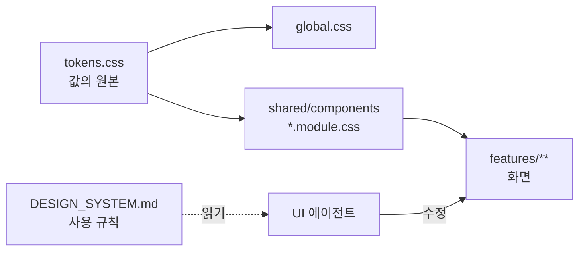

# 프런트엔드 디자인 시스템

UI를 만들거나 고치는 모든 에이전트가 읽는 규칙 문서입니다. **값의 원본은 `src/shared/styles/tokens.css`** 이고, 이 문서는 토큰 *이름*과 사용 규칙만 적습니다(값을 이 문서에 복제하지 않음).

## 1. 꼭 지킬 규칙

1. 색·간격·글자 크기·모서리·테두리 두께는 **tokens.css 변수만** 쓴다. 기능 CSS에 `#hex`, `rgb()`, 글자·간격용 `px` 값을 직접 쓰지 않는다.
   - 예외: 레이아웃 고정 폭(`minmax(14rem, 1fr)` 등), 미디어 쿼리(변수 사용 불가), SVG 선 굵기·점선 패턴.
2. 버튼·입력·표·알림·배지·대화상자는 **`src/shared/components`의 컴포넌트**를 쓴다. 기능 화면에서 `<button>`, `<table>`, `<input>`을 직접 꾸미지 않는다.
3. 상태는 **색만으로 구분하지 않는다** — 기호(`aria-hidden`)와 글자를 함께 쓴다.
4. 모든 화면은 정상 외에 로딩·빈 결과·실패·권한 없음 상태를 구현한다(`StateNotice`, `QueryErrorNotice`).
5. 새 토큰·새 공통 컴포넌트·기존 값 변경이 필요하면 구현 전에 `docs/change-requests/`에 제안을 남긴다.

## 2. 문구

- 한국어 평서형 존댓말: "불러오는 중입니다", "표시할 데이터가 없습니다".
- 버튼은 동작 이름: "취소", "승인", "다시 시도", "최신 내용으로 다시 불러오기". 확인 대화상자의 확인 버튼은 "확인" 대신 동작 이름.
- 고정 용어: 버전 상태 `초안 · 검토 중 · 승인 · 대체됨 · 보관 · 알 수 없음`, 값 상태 `미정 · 값 있음 · 무제한 · 해당 없음 · 대기 불가`, 검증 `오류 N건, 경고 N건`.
- 해결 방법은 "해결 방법: …", 문의 안내는 "문의할 때 요청 ID `…`를 알려 주세요."
- 미정(unknown)을 0·빈칸으로 보이지 않게 한다(`knownValueText`).
- 장식용 이모지 금지. 상태 기호(✓ ✎ … ↺ ▣ ! ⚠ ⓘ ○ ⌕ ●)만 허용.

## 3. 토큰

| 분류 | 토큰 | 사용처 |
|---|---|---|
| 면 | `--color-bg` | 페이지 배경 |
| | `--color-surface` | 카드·표·입력·대화상자·메뉴 면 |
| | `--color-overlay` | 대화상자 뒤 배경 |
| 글자 | `--color-text` | 본문 |
| | `--color-text-muted` | 경로·힌트·단위·보조 설명·비활성 값 |
| 선 | `--color-border` | 모든 기본 테두리·구분선 (흰 면 대비 1.65:1 — 변경은 CR로) |
| 포커스 | `--color-focus`, `--focus-ring-width`, `--focus-ring-offset` | `:focus-visible` 외곽선 (global.css) |
| 강조 | `--color-primary`, `--color-primary-hover`, `--color-primary-text` | 주 버튼, 선택된 그래프 요소, 편집 패널 테두리 |
| 프로젝트 | `--project-accent-1`~`4`, `--accent-band-width` | 프로젝트 구분 띠. 이름·코드와 항상 함께 |
| 상태 | `--status-{neutral,info,success,warning,danger}-{bg,fg}` | 같은 단계 `-fg`를 `-bg` 위에. neutral-bg는 표 머리행·비활성 입력 면, warning-fg는 미저장·예시 데이터 문구, danger-fg는 오류 테두리·문구 |
| 글꼴 | `--font-sans`, `--font-mono` | 본문 / 코드·식별자(프로젝트 코드, 필드 경로) |
| 글자 크기 | `--text-xs` `--text-sm` `--text-md` `--text-lg` `--text-xl`, `--leading` | 아래 위계 참고 |
| | `--text-2xs` | 공정 그래프 노드 종류(SVG) 전용 |
| 간격 | `--space-1` `2` `3` `4` `6` `8` | 4px 단위. 이 밖의 값 금지 |
| 크기 | `--control-height`, `--sidebar-width`, `--number-input-width` | 버튼·입력 높이 / 사이드바 / 숫자 입력 폭 |
| 테두리 | `--border-width`, `--border-width-strong` | 기본 / 선택·편집 중 강조 |
| 모서리 | `--radius-sm`, `--radius-md` | 컨트롤·배지·메뉴 항목 / 표·알림·패널·섹션·대화상자 |
| 그림자 | `--shadow-popover` | 대화상자·드롭다운 메뉴에만 |

**글자 위계**: 페이지 제목 `text-xl` · 섹션·대화상자·편집 패널 제목 `text-lg` · 본문/알림 제목 `text-md` · 버튼·표·라벨·알림 본문 `text-sm` · 힌트·배지·범례 `text-xs`. 라벨·범례 600, 배지 600, 정렬 머리·현재 메뉴 700. 본문 줄높이 `--leading`, 제목 1.25.

**비활성**: 버튼은 투명도 0.55 + `not-allowed`. 입력(`Fields`, `QuantityInput`, `KnownValueInput`)은 `--status-neutral-bg` 면 + `--color-text-muted` 글자.

## 4. 공통 컴포넌트 (`src/shared/components`)

### 동작
- **Button / LinkButton** — 동작은 `Button`, 화면 이동은 `LinkButton`. 화면당 `variant="primary"` 하나. `type` 기본 `"button"`.

### 입력
- **TextField · TextAreaField · SelectField · CheckboxField** (`Fields`) — `label` 필수, `hint`, `error`. 힌트·오류는 `aria-describedby`로 연결됨.
- **QuantityInput / QuantityRow** — 값+단위. 값은 decimal 문자열(숫자로 왕복 금지). 단위가 하나면 고정 표시, 여럿이면 선택.
- **KnownValueInput** — 미정/값 있음/무제한/해당 없음/대기 불가 구분. `allowedModes`는 계약이 허용하는 상태만. 목록 표시는 `knownValueText`.

### 데이터
- **DataTable** — `caption` 필수(화면에선 숨김). 정렬은 호출한 쪽이 수행, 표는 `aria-sort`와 ▲▼↕만 표시. 숫자 열 `align: "end"`, 현재 행 `currentRowKey`, 열이 많으면 `wrapCells`.
- **VersionStatusBadge** — 서버 상태 문자열을 기호+이름으로. 모르는 값은 "? 알 수 없음". 배지 밖 문구는 `VERSION_STATUS_LABELS`.

### 상태·피드백
- **StateNotice** — `loading · empty · no-results`(neutral), `error · forbidden`(danger), `conflict`(warning), `contract-pending`(info). 해결 동작은 `action`에 `Button`.
- **QueryErrorNotice** — 조회 실패를 종류별 안내로. `subject`("자산 목록"), `onRetry`.
- **SaveErrorNotice** — 저장·전이 실패 안내(412·422는 화면 전용 UI가 처리).
- **ConflictNotice** — 412 동시 수정 충돌. 자동 덮어쓰기 없이 "다시 불러오기 / 계속 편집" 선택.
- **ValidationPanel** — 오류는 항상 펼침, 경고 3건 초과 시 접음. 오류 있으면 danger 테두리, 경고만이면 warning 테두리.

### 대화상자
- **ConfirmDialog** — 되돌리기 어려운 동작 확인. 포커스 가둠·Esc·포커스 복귀는 Radix.
- **ReasonDialog** — 사유 필수 확인(반려 등). 공백만은 빈 값, `maxLength`는 계약 값.

### 레이아웃
- **PageHeader** — 페이지당 하나. 경로·제목·작업 버튼. 링크는 `renderLink` 주입.
- **Section** — 상세·편집 화면 섹션 카드(`radius-md`, `space-4`).
- **FieldGrid** — 입력 격자(좁은 화면 한 줄). **FilterBar** — 검색·필터 줄(`role="search"`).
- **Note** — 보조 설명. **SampleDataNotice** — 예시 데이터 표시(화면 상단, warning 글자). **DirtyIndicator** — "● 저장하지 않은 변경이 있습니다". **Block** — 블록 간격.
- **PreviewStateLinks** — 정적 단계 전용 상태 미리보기 링크.
- **ProjectSwitcher** — 현재 프로젝트 이름+코드+구분 띠. 전환 전 미저장 확인은 호출한 쪽 가드.

## 5. 화면 패턴

- **앱 셸** (`app/layout/AppShell`): 상단 바 `color-surface` + 하단 테두리, 사이드바 `--sidebar-width`, 현재 메뉴 `status-info` + 700, 본문 여백 `space-6`(좁은 화면 `space-4`), 건너뛰기 링크 제공.
- **공정 그래프** (`features/processes/GraphDiagram`): 노드 종류는 색 + 종류 이름 + 테두리 모양으로 구분(operation=info-bg, buffer=neutral-bg 점선, source/sink=success-bg, join/milestone=warning-bg). 선택 `color-primary`, 오류 `status-danger-fg`, 포커스·hover `color-focus`. 간선은 실선(자재)·긴 점선(완료 의존)·짧은 점선(직결 공급)으로 구분하고 범례를 함께 둔다.
- **편집 패널** (`StepEditPanel`): `status-neutral-bg` 면 + `--border-width-strong` `color-primary` 테두리로 편집 중임을 표시.

## 6. 새 UI를 만들 때 체크리스트

- [ ] 토큰 외 색·간격·글자 크기 값이 없다 (`rg '#[0-9a-fA-F]{3,8}|rgba?\(|[0-9]+px' -g '*.css' src`)
- [ ] 공통 컴포넌트로 만들 수 있는 것을 새로 만들지 않았다
- [ ] 로딩·빈 결과·실패·권한 없음 상태가 있다
- [ ] 상태·선택·오류를 색 외에 글자/기호로도 알린다
- [ ] 모든 입력에 라벨이 있고 오류가 `aria-describedby`로 연결된다
- [ ] 미정과 0/빈칸을 구분해 표시한다

시각 카탈로그(사람 검토용): claude.ai Design System "시뮬레이션 플랫폼" — 코드가 원본이며, 토큰을 바꾸면 카탈로그를 다시 동기화한다.
